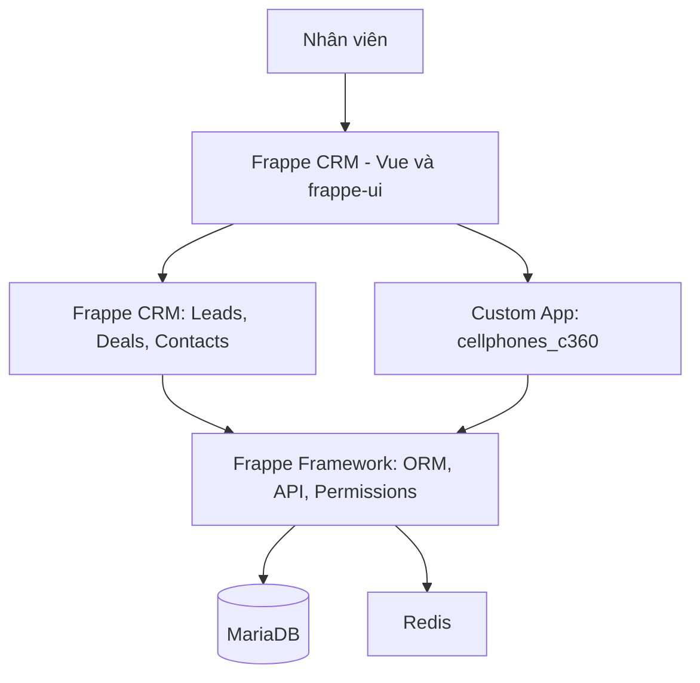

# CellphoneS Customer 360

Hệ thống CRM phục vụ nhân viên CellphoneS quản lý hồ sơ khách hàng tập trung, theo dõi cơ hội bán hàng, đơn hàng và hoạt động chăm sóc sau bán. Đây là đồ án học tập, sử dụng dữ liệu demo, không phải hệ thống chính thức của CellphoneS.

## 1. Mục tiêu và phạm vi

- Tận dụng chức năng có sẵn của Frappe CRM: Leads, Deals, Contacts, Tasks, Notes và các chức năng quản lý CRM liên quan.
- Mở rộng Frappe CRM bằng Custom App `cellphones_c360` để xây dựng hồ sơ Customer 360, liên kết đơn hàng và yêu cầu hỗ trợ.
- Hướng tới quản lý khách hàng B2C đa kênh, kiểm tra dữ liệu trùng lặp, quản lý hậu mãi và phân tích khách hàng.
- Giao diện dành cho nhân viên; không phải website bán hàng cho khách đặt mua sản phẩm.

## 2. Công nghệ và kiến trúc

| Thành phần | Công nghệ |
|---|---|
| Framework | Frappe Framework 15.126.1, nhánh version-15 |
| CRM | Frappe CRM 1.92.0 |
| Frontend | Vue.js, frappe-ui, giao diện Frappe CRM tùy chỉnh |
| Backend mở rộng | Python, Frappe ORM, Custom App `cellphones_c360` 0.0.1 |
| Database | MariaDB 10.8 |
| Hạ tầng phát triển | Docker Compose, Redis, Frappe Bench, Python 3.12.15 |
| Xác thực | Frappe Session; frontend và backend cùng origin |



Không sử dụng frontend React độc lập trong nhánh phát triển mới. Các phiên bản cũ vẫn có thể tham khảo qua lịch sử Git.

## 3. Cấu trúc repository

```text
cellphones-customer360/
├── backend/
│   └── cellphones_c360/       # Custom App duy nhất
├── data/                     # Tài liệu và dữ liệu mẫu
├── deployment/
│   └── cellphones-c360/       # Docker, release nguồn và Snapshot
├── docs/
│   ├── api/                  # API Contract
│   ├── design/               # CV02, CV03 và tài liệu thiết kế
│   ├── frappe/               # Tài liệu kỹ thuật
│   ├── integration/          # Tài liệu tích hợp
│   ├── deployment/           # Cài đặt và bàn giao
│   └── testing/              # BPMN, test report và kịch bản demo
├── frappe-crm-native/
│   └── patches/
│       └── cellphones-c360.patch
├── screenshots/              # Minh chứng thực hiện
└── README.md
```

Thư mục `backend/cellphones_c360` là nguồn chính cho Custom App. Không duy trì thêm bản backend trùng lặp trong bộ triển khai. Tệp patch lưu thay đổi mã nguồn giao diện trong repository Frappe CRM; không phải bản sao đầy đủ của Frappe CRM.

## 4. Trạng thái triển khai (24/11/2026)

| Phân hệ | Trạng thái |
|---|---|
| Hồ sơ Customer 360 | Tạo, sửa, tìm kiếm, phân khúc, năm tab và Timeline đã kiểm thử trên site hiện có |
| Đa kênh và hợp nhất | CSV có lịch sử và khả năng replay, đối chiếu và merge đã kiểm thử cả thành công lẫn rollback |
| Lead, Deal và Contact | Dùng CRM gốc, hỗ trợ nhiều cơ hội và mua lại trên một khách hàng |
| Orders và After-sales | Danh sách CRM, form chuẩn Frappe, thanh toán/giao nhận, Ticket và lịch CRM Task |
| Customer Analytics | KPI và biểu đồ theo kỳ, tách giá trị đơn khỏi khoản thu xác nhận |
| Thương hiệu | Logo, favicon, CSS CellphoneS, hỗ trợ điều hướng tab bàn phím và màn hình nhỏ |
| Phân quyền | Đã áp dụng trên `crm.localhost` và kiểm thử Administrator, System Manager, Sales Manager, Sales User, CSKH, Vận hành, Marketing và quyền phê duyệt hợp nhất |
| Triển khai nguồn | Đã kiểm tra scripts, Git Patch, Verify và demo trial trên site hiện có. Cài New/Snapshot cần môi trường được duyệt |
| GitHub | Nhánh bàn giao là `feature/frappe-crm-native` |

### DocType tùy chỉnh

`C360 Customer`, `C360 Source Record`, `Customer Order`, `Customer Order Item`, `Customer Support Ticket`, `C360 Registration Request`.

## 5. Chạy môi trường phát triển hiện có

Các bước dưới đây dành cho máy đã có Docker, Bench Volume, site `crm.localhost` và các ứng dụng cần thiết. Không phải hướng dẫn cài mới hoàn chỉnh.

Mở Docker Desktop. Trong PowerShell tại thư mục chứa Docker Compose phát triển, chạy:

```powershell
docker compose up -d
docker compose ps
```

Đường dẫn bind mount Custom App trên máy phải trỏ tới `backend/cellphones_c360` trong repository, đích trong container là `/home/frappe/frappe-bench/apps/cellphones_c360`.

Trên môi trường phát triển hiện tại (container `crm-frappe-1`), kiểm tra ứng dụng:

```powershell
docker exec -u frappe -w /home/frappe/frappe-bench crm-frappe-1 bench --site crm.localhost list-apps
```

Mở <http://crm.localhost:8000/crm> và <http://crm.localhost:8000/crm/customer360>. Đăng nhập bằng tài khoản được cấp quyền. Không chia sẻ mật khẩu trong Git.

Dừng môi trường bằng `docker compose stop` tại thư mục Compose. Không xóa volume để dừng hệ thống.

## 6. Phát triển giao diện Frappe CRM

- Repository nguồn CRM trong container: `/home/frappe/frappe-bench/apps/crm`.
- Commit nền: `638bf3db23e7142870819a213368e028866b79b1`.
- Nhánh tùy chỉnh trong CRM: `feature/cellphones-c360`.
- Git Patch lưu toàn bộ thay đổi từ base, gồm cả quyền truy cập CRM của các vai trò Customer 360.
- Nhánh repository đồ án: `feature/frappe-crm-native`.

Các file tùy chỉnh chính trong CRM: `frontend/src/cellphones-theme.css`, `frontend/src/index.css`, `frontend/src/router.js`, `frontend/src/components/Layouts/AppSidebar.vue`, `frontend/src/pages/Customer360.vue`, `frontend/src/pages/Customer360Detail.vue`.

Sau khi sửa frontend trên môi trường hiện tại:

```powershell
docker exec -u frappe -w /home/frappe/frappe-bench crm-frappe-1 bench build --app crm
```

Tải lại trình duyệt bằng Ctrl+F5. Commit trong repository CRM, xuất lại patch từ commit nền đến HEAD và commit patch vào repository đồ án. Không chỉ lưu thay đổi trong Docker Volume.

Đối với máy khác: cần có mã nguồn CRM đúng commit nền, cây Git sạch, Custom App và site tương thích trước khi áp dụng patch bằng `git am <duong-dan-patch>` trong repository CRM. Kiểm tra lịch sử Git trước; không áp dụng lại trên môi trường đã có các commit tùy chỉnh. Sau đó build và kiểm thử. Quy trình triển khai mới trên máy khác chưa được xác nhận hoàn chỉnh.

## 7. Bộ triển khai và bàn giao

`deployment/cellphones-c360/` hỗ trợ Verify, New và Update từ mã nguồn. Trên site đang chạy, dùng `./deployment/cellphones-c360/setup-source.ps1 -Mode Verify -Site crm.localhost` để kiểm tra gói ứng dụng. Patch chính đã bao gồm quyền các phòng ban. Quy trình cài từ đầu trên máy sạch chưa được kiểm thử.

Bộ demo có thể chạy thử và hoàn tác bằng `./deployment/cellphones-c360/import-demo.ps1`. [Snapshot CSV demo-v2](data/snapshots/demo-v2) kèm manifest là bộ dữ liệu riêng. Preflight trên site hiện có phát hiện dữ liệu trùng và 11 ticket không đáp ứng quy tắc đơn hàng đã hoàn tất. Chế độ Snapshot của script setup dành cho bộ sao lưu ngày 22/11/2026.

Logo public có URL `/assets/cellphones_c360/branding/cellphones-brand.png`. Backup và cấu hình từng site được quản lý ngoài Git.

Xem [Installation Guide](docs/deployment/installation-guide.md), [Deployment Guide](docs/deployment/deployment-guide.md) và [Git workflow](docs/deployment/git-workflow.md).

## 8. Tài liệu và nguyên tắc bảo mật

- [API Contract](docs/api/api-contract.md)
- [Data Dictionary](docs/design/data-dictionary.md), [ERD](docs/design/erd.md) và [BPMN](docs/design/bpmn.md)
- [Permission Matrix](docs/design/permission-matrix.md) và [User Guide](docs/user-guide.md)
- [Test Report](docs/testing/test-report.md), [Demo Scenario](docs/testing/demo-scenario.md) và [Known Issues](docs/known-issues.md)
- [Tài liệu thiết kế](docs/design/)
- [Tài liệu Frappe](docs/frappe/)
- [Tài liệu tích hợp](docs/integration/)

Không commit `.env`, mật khẩu, token, cookie, `site_config.json` có bí mật, bản sao lưu database chứa dữ liệu cá nhân, file cache hoặc thư viện sinh tự động. Chỉ chia sẻ dữ liệu demo đã được kiểm tra; lưu backup an toàn ngoài Git. Kiểm thử quyền trên server bằng tài khoản nghiệp vụ, không chỉ Administrator.
