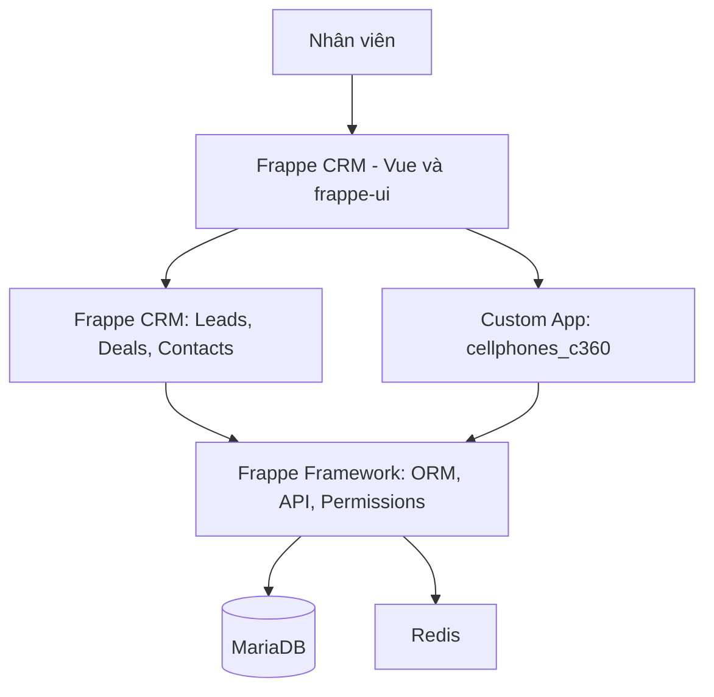

# CellphoneS Customer 360

Hệ thống CRM phục vụ nhân viên CellphoneS quản lý hồ sơ khách hàng tập trung, theo dõi cơ hội bán hàng, đơn hàng và hoạt động chăm sóc sau bán. Đây là đồ án học tập, sử dụng dữ liệu demo, không phải hệ thống chính thức của CellphoneS.

## 1. Mục tiêu và phạm vi

- Tận dụng chức năng có sẵn của Frappe CRM: Leads, Deals, Contacts, Tasks, Notes và các chức năng quản lý CRM liên quan.
- Mở rộng Frappe CRM bằng Custom App `cellphones_c360` để xây dựng hồ sơ Customer 360, liên kết đơn hàng và yêu cầu hỗ trợ.
- Hướng tới quản lý khách hàng B2C đa kênh, kiểm tra dữ liệu trùng lặp, quản lý hậu mãi và phân tích khách hàng.
- Giao diện dành cho nhân viên; không phải website bán hàng cho khách đặt mua sản phẩm.

## 2. Công nghệ và kiến trúc

| Thành phần | Công nghệ |
|---|---|
| Framework | Frappe Framework 15.126.1, nhánh version-15 |
| CRM | Frappe CRM 1.92.0 |
| Frontend | Vue.js, frappe-ui, giao diện Frappe CRM tùy chỉnh |
| Backend mở rộng | Python, Frappe ORM, Custom App `cellphones_c360` 0.0.1 |
| Database | MariaDB 10.8 |
| Hạ tầng phát triển | Docker Compose, Redis, Frappe Bench, Python 3.12.15 |
| Xác thực | Frappe Session; frontend và backend cùng origin |



Không sử dụng frontend React độc lập trong nhánh phát triển mới. Các phiên bản cũ vẫn có thể tham khảo qua lịch sử Git.

## 3. Cấu trúc repository

```text
cellphones-customer360/
├── backend/
│   └── cellphones_c360/       # Custom App duy nhất
├── data/                     # Tài liệu và dữ liệu mẫu
├── deployment/
│   └── cellphones-c360/       # Docker và script Snapshot
├── docs/
│   ├── api/                  # API Contract
│   ├── design/               # CV02, CV03 và tài liệu thiết kế
│   ├── frappe/               # Tài liệu kỹ thuật
│   └── integration/          # Tài liệu tích hợp
├── frappe-crm-native/
│   └── patches/
│       └── cellphones-c360.patch
├── screenshots/              # Minh chứng thực hiện
└── README.md
```

Thư mục `backend/cellphones_c360` là nguồn chính cho Custom App. Không duy trì thêm bản backend trùng lặp trong bộ triển khai. Tệp patch lưu thay đổi mã nguồn giao diện trong repository Frappe CRM; không phải bản sao đầy đủ của Frappe CRM.

## 4. Trạng thái triển khai (24/11/2026)

| Phân hệ | Trạng thái |
|---|---|
| Leads, Deals, Contacts, Tasks | Tận dụng giao diện và chức năng Frappe CRM; kiểm thử nghiệp vụ theo role còn cần bổ sung |
| Thương hiệu CellphoneS | Đã thiết lập tên, logo, favicon và theme cơ bản |
| Customer 360 – danh sách | Đã hiển thị dữ liệu backend, có tìm kiếm và phân trang; cần kiểm thử biên |
| Customer 360 – hồ sơ | Đã kiểm tra hiển thị Overview, Orders, Leads & Deals, After-sales, Timeline với Administrator |
| Tạo/sửa khách hàng trong giao diện mới | Chưa tích hợp và kiểm thử |
| Hợp nhất khách hàng đa kênh | Cần hoàn thiện và kiểm thử quy tắc nghiệp vụ |
| Orders và After-sales | Đã có DocType, hiển thị trong hồ sơ; màn hình quản lý riêng chưa hoàn thiện |
| Dashboard, Analytics | Tận dụng chức năng có sẵn và rà soát API mở rộng; chưa xác nhận tích hợp mới |
| Phân quyền, bảo mật | Cần kiểm thử theo role, quyền tài liệu và quyền trường |
| Deployment Snapshot | Đã đổi đường dẫn backend; chưa kiểm thử lại theo kiến trúc mới |

### DocType tùy chỉnh

`C360 Customer`, `Customer Order`, `Customer Order Item`, `Customer Support Ticket`, `C360 Registration Request`.

## 5. Chạy môi trường phát triển hiện có

Các bước dưới đây dành cho máy đã có Docker, Bench Volume, site `crm.localhost` và các ứng dụng cần thiết. Không phải hướng dẫn cài mới hoàn chỉnh.

Mở Docker Desktop. Trong PowerShell tại thư mục chứa Docker Compose phát triển, chạy:

```powershell
docker compose up -d
docker compose ps
```

Đường dẫn bind mount Custom App trên máy phải trỏ tới `backend/cellphones_c360` trong repository, đích trong container là `/home/frappe/frappe-bench/apps/cellphones_c360`.

Trên môi trường phát triển hiện tại (container `crm-frappe-1`), kiểm tra ứng dụng:

```powershell
docker exec -u frappe -w /home/frappe/frappe-bench crm-frappe-1 bench --site crm.localhost list-apps
```

Mở <http://crm.localhost:8000/crm> và <http://crm.localhost:8000/crm/customer360>. Đăng nhập bằng tài khoản được cấp quyền. Không chia sẻ mật khẩu trong Git.

Dừng môi trường bằng `docker compose stop` tại thư mục Compose. Không xóa volume để dừng hệ thống.

## 6. Phát triển giao diện Frappe CRM

- Repository nguồn CRM trong container: `/home/frappe/frappe-bench/apps/crm`.
- Commit nền: `638bf3db23e7142870819a213368e028866b79b1`.
- Nhánh tùy chỉnh trong CRM: `feature/cellphones-c360`.
- Ba commit đã xuất patch: `820f0af`, `5d45d37`, `261dc53`.
- Nhánh repository đồ án: `feature/frappe-crm-native`.

Các file tùy chỉnh chính trong CRM: `frontend/src/cellphones-theme.css`, `frontend/src/index.css`, `frontend/src/router.js`, `frontend/src/components/Layouts/AppSidebar.vue`, `frontend/src/pages/Customer360.vue`, `frontend/src/pages/Customer360Detail.vue`.

Sau khi sửa frontend trên môi trường hiện tại:

```powershell
docker exec -u frappe -w /home/frappe/frappe-bench crm-frappe-1 bench build --app crm
```

Tải lại trình duyệt bằng Ctrl+F5. Commit trong repository CRM, xuất lại patch từ commit nền đến HEAD và commit patch vào repository đồ án. Không chỉ lưu thay đổi trong Docker Volume.

Đối với máy khác: cần có mã nguồn CRM đúng commit nền, cây Git sạch, Custom App và site tương thích trước khi áp dụng patch bằng `git am <duong-dan-patch>` trong repository CRM. Kiểm tra lịch sử Git trước; không áp dụng lại trên môi trường đã có các commit tùy chỉnh. Sau đó build và kiểm thử. Quy trình triển khai mới trên máy khác chưa được xác nhận hoàn chỉnh.

## 7. Bộ triển khai và bàn giao

`deployment/cellphones-c360/` chứa bộ Snapshot dựa trên bản sao lưu ngày 22/11/2026. Script đã chuyển sang backend dùng chung nhưng chưa có quy trình áp dụng patch mới được kiểm thử. Không xem bộ Snapshot hiện tại là bản bàn giao mới nhất; không chạy đè lên môi trường đang hoạt động.

Trước khi bàn giao cần cập nhật backup, kiểm tra phiên bản CRM trong bản sao lưu, áp dụng patch đúng cách, cấu hình thương hiệu, kiểm tra quyền, chạy thử trên môi trường riêng khi nhóm quyết định. Dữ liệu, site config, logo tải lên và cấu hình thương hiệu trong database không nằm trong Git Patch.

## 8. Tài liệu và nguyên tắc bảo mật

- [API Contract](docs/api/api-contract.md)
- [Tài liệu thiết kế](docs/design/)
- [Tài liệu Frappe](docs/frappe/)
- [Tài liệu tích hợp](docs/integration/)

Không commit `.env`, mật khẩu, token, cookie, `site_config.json` có bí mật, bản sao lưu database chứa dữ liệu cá nhân, file cache hoặc thư viện sinh tự động. Chỉ chia sẻ dữ liệu demo đã được kiểm tra; lưu backup an toàn ngoài Git. Kiểm thử quyền trên server bằng tài khoản nghiệp vụ, không chỉ Administrator.
