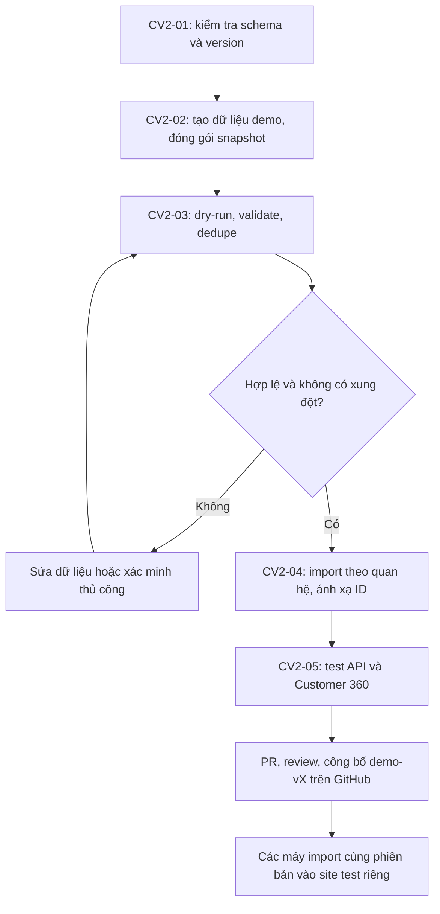

# GIAI ĐOẠN 2 – CV2-01 đến CV2-05 (bản điều chỉnh theo snapshot)

**Dự án:** CellphoneS Customer 360 – React + Frappe CRM + MariaDB
**Cách chia sẻ dữ liệu:** GitHub lưu **snapshot dữ liệu DEMO đã xử lý an toàn**, mỗi thành viên import vào Frappe độc lập; GitHub **không đồng bộ database theo thời gian thực**.
**Nguồn chỉnh sửa:** Bộ CV2 patch trước đó, dựa trên source `51c5c54`; mọi metadata CRM và thao tác Frappe vẫn phải kiểm chứng trên site thực tế.

## Mục tiêu điều chỉnh

1. Dữ liệu Customer/Lead/Deal/Order/Ticket và lịch sử đa kênh lưu thực vào Frappe, liên kết được theo Customer.
2. Mỗi người dựng được **cùng một bộ dữ liệu thử nghiệm và quan hệ tương đương** từ snapshot `demo-v1` qua quy trình tái lập có kiểm soát.
3. Snapshot có manifest, phiên bản schema, bảng ánh xạ ID, kiểm tra dữ liệu/quan hệ và quy trình cập nhật qua PR.
4. Không đẩy bản sao lưu database thật, tài khoản, API key, `site_config.json` hoặc dữ liệu khách hàng thật lên GitHub.
5. **Tránh hiểu nhầm:** chỉnh sửa trên máy A không hiện trên máy B cho đến khi có snapshot mới được công bố và nhập lại; đây không phải giải pháp Frappe dùng chung live.

## Công việc và đầu ra sau điều chỉnh

### CV2-01 – Kiểm tra, chuẩn hóa schema Frappe và quy chuẩn snapshot

**Mục tiêu:** Bảo đảm các máy đều có cấu trúc dữ liệu/Custom Field và quan hệ tương thích trước khi nhập cùng snapshot.

**Thực hiện:**
- Kiểm tra thực tế các DocType `CRM Lead`, `CRM Deal`, `CRM Call Log`, `CRM Task`, `C360 Customer`, `C360 Customer Intake`, `Customer Order`, `Customer Order Item`, `Customer Support Ticket`, `C360 Registration Request`.
- Ghi fieldname/fieldtype/reqd/options/link, các Custom Field `custom_c360_customer`, `custom_consultation_notes` và quan hệ 1–N.
- Đối chiếu bản app/framework theo manifest; xác định trường bắt buộc trên máy nguồn và máy đích, không tự giả định CRM chuẩn giống hệt.
- Chốt **schema snapshot**: mã logic `snapshot_id`, tên file, loại dữ liệu, danh sách quan hệ, version, checksum SHA-256; lập thứ tự nhập.

**Output:** Data Dictionary + ERD cập nhật; báo cáo schema audit; `manifest.json` + `CV2-02-SNAPSHOT-GUIDE.md`.

**Đạt khi:** Mỗi máy kiểm tra đủ DocType/field cần thiết; không có broken links trước import; manifest và cấu trúc tập tin hợp lệ.

### CV2-02 – Chuẩn hóa dữ liệu đa kênh và đóng gói snapshot mẫu

**Mục tiêu:** Cùng dùng bộ dữ liệu giả lập ổn định, có quan hệ rõ ràng và có thể tái tạo.

**Thực hiện:**
- Giữ bộ CSV 12 lượt tiếp nhận Website/Facebook/Zalo/Hotline/Store (có cả các ca trùng, nghi trùng và không hợp lệ).
- Tạo snapshot DEMO cho Customer, Lead, Deal, Order, Order Item, Ticket, Intake; trường `snapshot_id` là mã tham chiếu **trong gói**, không đồng nhất với `name` Frappe.
- Chỉ dùng dữ liệu giả lập/đã ẩn danh; thống nhất format phone/email/date, kênh, mã sản phẩm, trạng thái; đối chiếu số bản ghi trên từng file.
- Dự kiến luồng chuyển đổi snapshot thành record Frappe: **Customer → Lead → Deal → Order + Items → Ticket → Intake/tương tác**; khi import phải ghi bảng `snapshot_id -> frappe.name`.
- Trước khi phát hành bản snapshot chính thức, thử import trên **site test riêng**; lưu kết quả imported/skipped/review/error, version và hash vào biên bản.

**Output:** Gói `snapshots/demo-vX/` có CSV, manifest, kiểm tra tham chiếu, bảng mapping và report; kèm hướng dẫn cài dữ liệu.

**Đạt khi:** Bản demo được import thật vào một Frappe test; số bản ghi và liên kết khớp; thành viên khác tái tạo được mà không cần tạo tay.

### CV2-03 – Hợp lệ/trùng lặp và an toàn khi nhập lại snapshot

**Mục tiêu:** Không nhân đôi Customer hoặc gộp nhầm khi đồng bộ snapshot giữa các máy.

**Thực hiện:**
- Chuẩn hóa và validate họ tên/số điện thoại/email/nguồn; phân luồng **New / Linked / Needs Review / Rejected**.
- `source_channel + source_reference` là khóa nhập nguồn idempotent của `C360 Customer Intake`; trong gói snapshot dùng thêm `snapshot_id` để khôi phục liên kết.
- Chạy thử **dry-run**: phát hiện dữ liệu đã có, xung đột định danh, ID đã tồn tại, trường bắt buộc thiếu và tham chiếu mồ côi.
- Bản chính thức chỉ tự liên kết khi chắc chắn, còn nghi trùng phải đợi xác minh; không overwrite thông tin đã thay đổi cục bộ một cách âm thầm.
- Thiết kế quy tắc nâng phiên bản snapshot: import lần 2 không tạo bản ghi lặp; khi đã sửa dữ liệu cục bộ, phải cảnh báo xung đột hoặc dùng site test sạch.

**Output:** Quy tắc dedupe, báo cáo dry-run, test case idempotence/review/conflict, bảng source key và snapshot ID.

**Đạt khi:** Import lần 2 không phát sinh bản ghi thừa; các ca trùng và nghi trùng được xử lý rõ ràng, có log kiểm chứng từ Frappe.

### CV2-04 – Bảo toàn quan hệ Customer–Lead–Deal–Order–Ticket trong snapshot

**Mục tiêu:** Dữ liệu được liên kết đúng sau khi nhập trên bất kỳ máy nào, dù `name` tự sinh trong Frappe khác nhau.

**Thực hiện:**
- Giữ `CRM Lead.custom_c360_customer`, `CRM Deal.custom_c360_customer`, `CRM Deal.lead`, `Customer Order.customer`, `Customer Order.items`, `Customer Support Ticket.customer/related_order`.
- Snapshot chỉ tham chiếu **ID logic** như `CUS-001`, `LEAD-001`, `ORDER-001`; importer ánh xạ ID logic sang Frappe `name` ở máy đang import.
- Kiểm tra Deal trỏ về Lead và Customer thống nhất; Ticket/Order đúng Customer; Order Item thuộc Order cha; không có mồ côi.
- Không gán thẳng mã ID logic vào trường Link nếu Frappe chưa tạo bản ghi tương ứng.

**Output:** ERD có quy tắc ID snapshot; bảng ánh xạ Customer/Lead/Deal/Order/Ticket; report kiểm tra quan hệ; test case.

**Đạt khi:** Từ một Customer ID Frappe có thể truy xuất Lead/Deal/Order/Ticket đúng sau import, dù các máy có `name` khác nhau.

### CV2-05 – Hoàn thiện API Customer 360 và kiểm tra với snapshot

**Mục tiêu:** API hiện có hiển thị được hồ sơ hợp nhất từ bộ snapshot khi nhập vào Frappe ở các máy khác nhau.

**Thực hiện:**
- Dùng API sẵn có `cellphones_c360.api.customer360.get_customer_360` và các API hồ sơ/timeline; giữ cấu trúc cũ cho React.
- Truy xuất nhiều Lead, Deal, Order, Ticket, nguồn tiếp nhận và tương tác theo Customer ID; xử lý danh sách rỗng và quyền xem.
- Kiểm thử API sau khi nhập `demo-v1`: đối chiếu record, quan hệ, timeline, các trường `order_id`, `purchased_at`, `total`… mà React cần.
- Test với 2 thành viên trên hai site độc lập cùng snapshot; so sánh dữ liệu logic (không so sánh ID Frappe máy A với B).
- Ghi kết quả API, screenshot UI, danh sách khác biệt và tình trạng fix; khi release `demo-v2`, chạy lại kiểm tra.

**Output:** API contract JSON, test case Customer 360, bảng đối chiếu hai máy cùng snapshot, biên bản nghiệm thu bản snapshot.

**Đạt khi:** API và React hiển thị đủ lịch sử khách hàng trên site thử nghiệm, các số liệu tương ứng trùng theo snapshot, quyền truy cập phù hợp.

## Luồng thực hiện được khuyến nghị

## Phân chia trách nhiệm (có thể giao độc lập, chỉ cần đầu vào thống nhất)

| CV | Có thể giao | Điều cần bàn giao |
|---|---|---|
| 01 | Thành viên phụ trách Backend/schema | Data Dictionary, ERD, version và field mapping |
| 02 | Thành viên phụ trách dữ liệu | CSV/JSON demo sạch, manifest, checksum, report |
| 03 | Thành viên phụ trách validation | Dedupe, dry-run, test lần nhập lặp |
| 04 | Thành viên phụ trách quan hệ | Bảng logical ID→Frappe ID, test liên kết |
| 05 | Thành viên phụ trách API Customer 360 | JSON/API tests và ảnh UI từ dữ liệu snapshot |

## Phân biệt 3 loại dữ liệu cần tránh nhầm

| Loại | Nơi lưu | Đưa lên GitHub? |
|---|---|---|
| **Code/schema/migration** | `backend/cellphones_c360/` | Có, qua PR |
| **Snapshot dữ liệu DEMO, không nhạy cảm** | `Docs/CV2-01-05/snapshots/demo-vX/` | Có, sau review |
| **Backup database Frappe thật + files/config** | Backup riêng ngoài repo | **Không**; chỉ lưu an toàn nội bộ |

**An toàn:** Không commit `.env`, API token, mật khẩu, `site_config.json`, backup `.sql`/`.sql.gz`, ảnh/file đính kèm khách hàng thật. Nếu chỉ còn dữ liệu của bạn trong Frappe, cần xác nhận đó là dữ liệu giả lập hoặc được phép chia sẻ, rồi xuất/ẩn danh trước khi đưa vào Git. Snapshot DEMO không bao gồm tài khoản đăng nhập, mật khẩu hoặc phân quyền người dùng.

**Trạng thái:** Đây là kế hoạch và bộ quy tắc mới; chưa thể khẳng định import/restore thật đã PASS trên máy của nhóm. Việc tạo seed importer tương thích Frappe và chạy thử trên Docker phải thực hiện và ghi log trước khi nghiệm thu.
