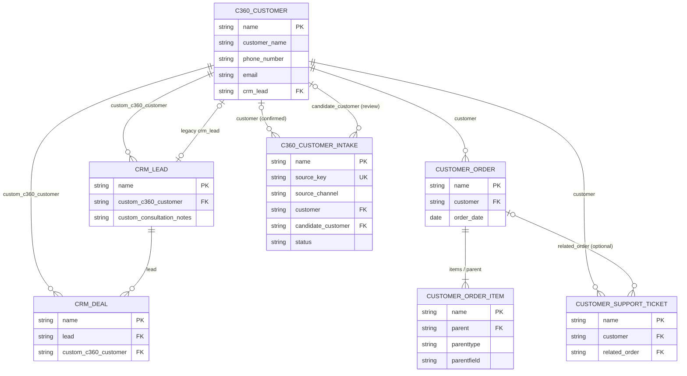

# CV2-01 / CV2-04 – Sơ đồ ERD đề xuất

Sơ đồ được dựng từ các Link/Table trong source và ba Custom Field bổ sung. `CRM Lead`/`CRM Deal` vẫn cần đối chiếu metadata thực tế.

**Quy tắc:** Một khách hàng có 0..n Lead, Deal, Order, Ticket và intake. Deal liên kết Customer trực tiếp hoặc qua Lead; khi có cả hai, Customer phải trùng. Ticket có `related_order` thì Order bắt buộc thuộc chính Customer đó. `crm_lead` được giữ để tương thích dữ liệu cũ, không phải nguồn duy nhất để tổng hợp.

**Ghi chú:** Mermaid thể hiện quan hệ logic, không phải toàn bộ khoá ngoại SQL vật lý; Frappe Link field không nhất thiết tạo ràng buộc FOREIGN KEY trong MariaDB. `Customer Order Item` thuộc Table của Order qua cột hệ thống `parent`.
