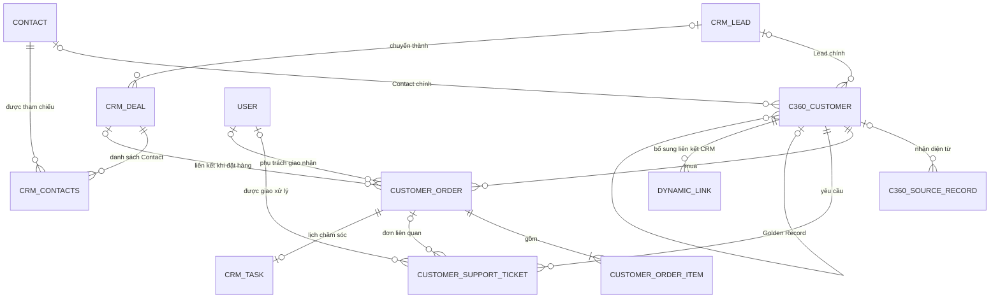

# ERD Customer 360

`Dynamic Link` chỉ nhận Contact, CRM Lead và CRM Deal. Bản ghi nguồn có thể chưa gắn Customer trong khi chờ xác minh. Version và các sự kiện giữ tham chiếu tới tài liệu gốc và được lọc theo quyền trên Timeline.
